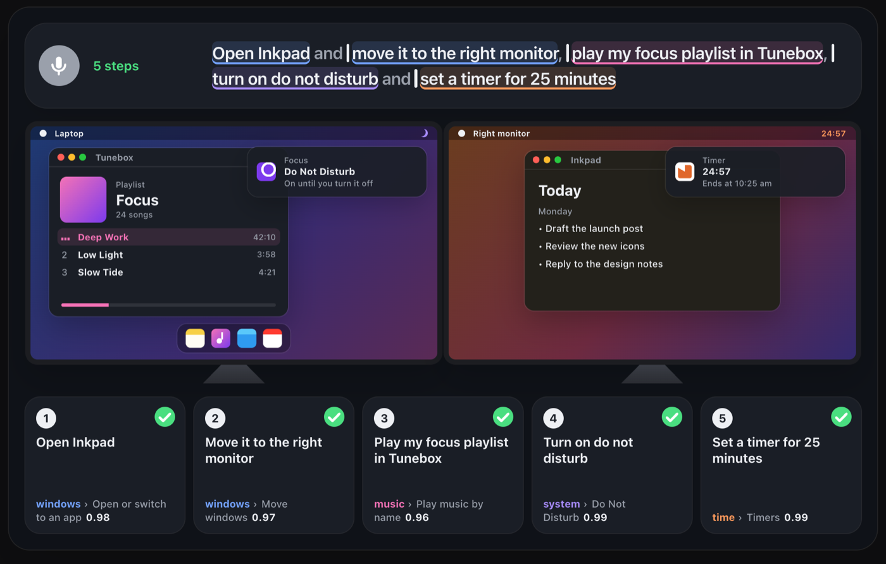
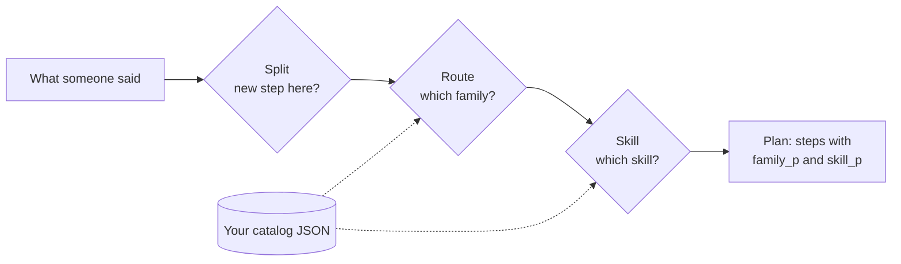
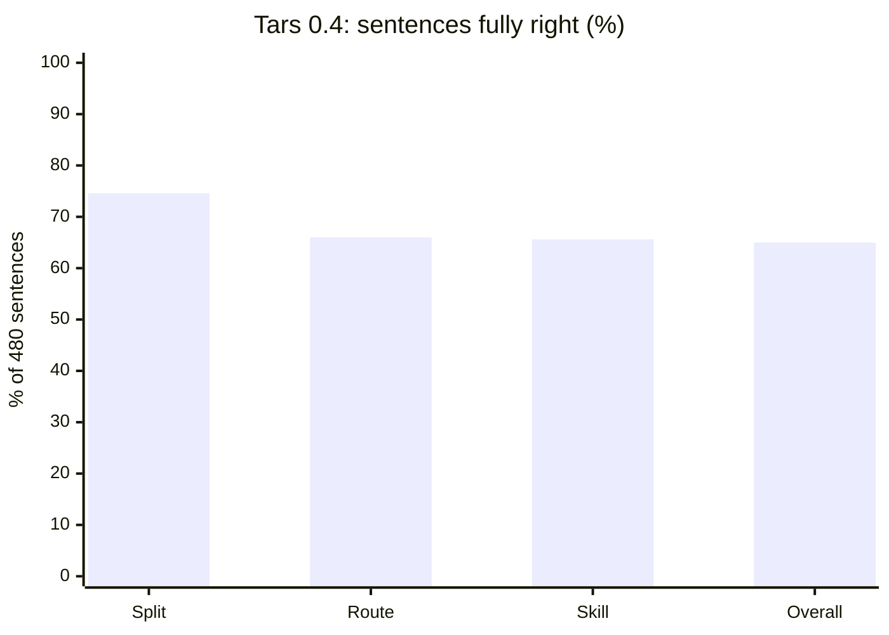
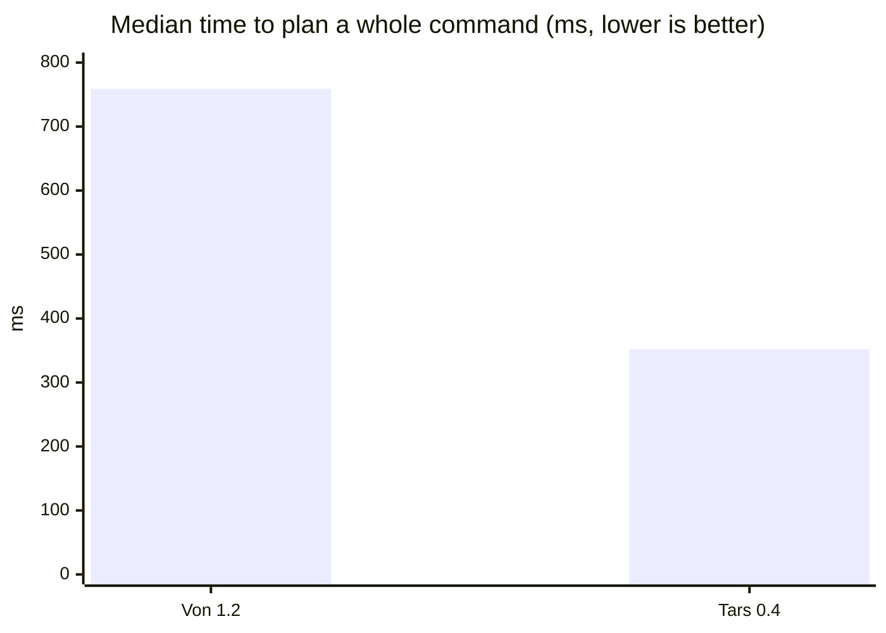
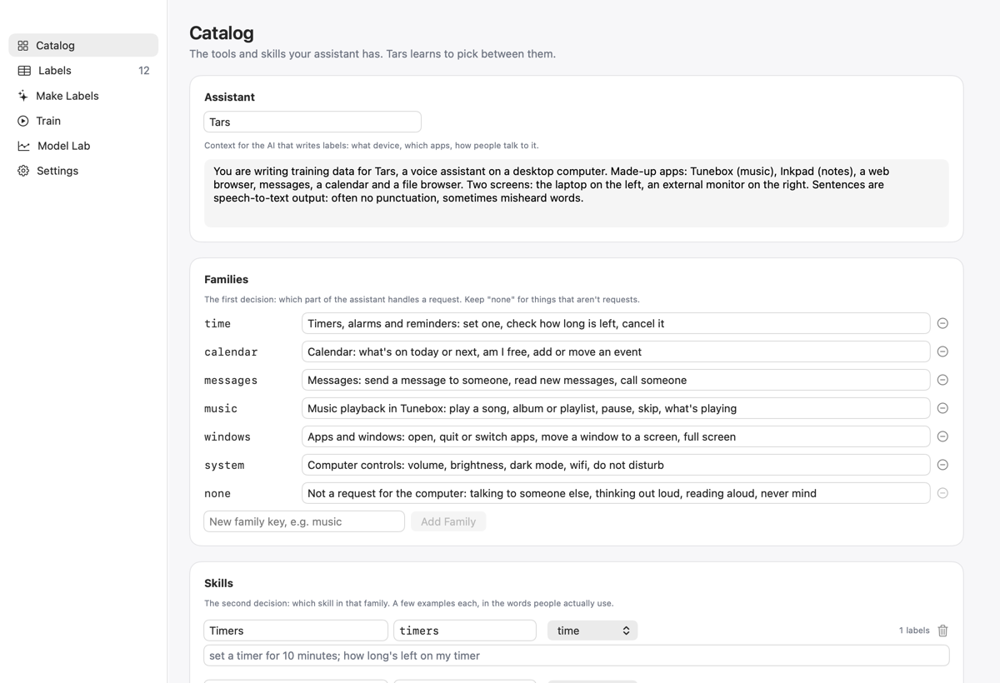
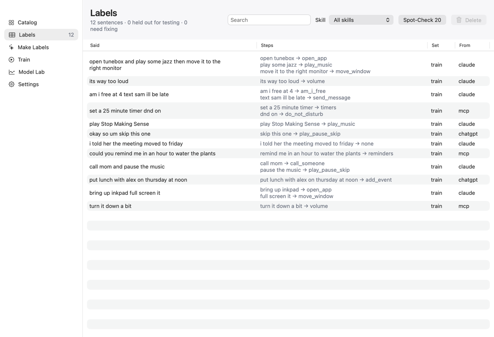
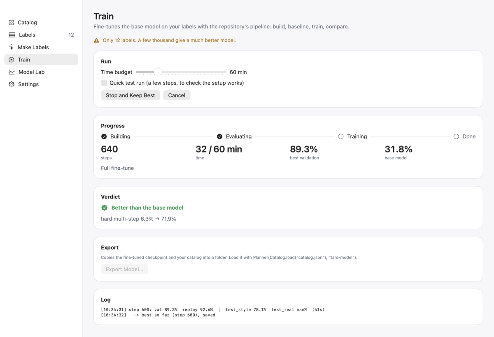
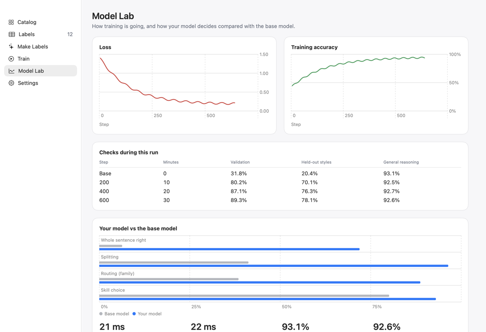
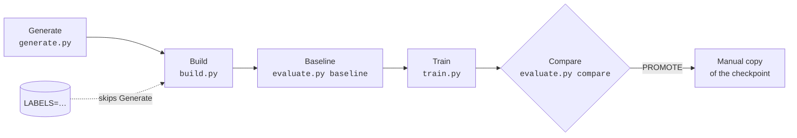

<div align="center">


# Tars

**A small local model that decides what to do with a spoken command.**

[](https://github.com/andrewneuwirth/Tars/actions/workflows/ci.yml)
[](https://github.com/andrewneuwirth/Tars/releases/latest)
[](LICENSE)
[](pyproject.toml)
[](app/README.md)
[](app/README.md)
[](https://github.com/wfzyx/von)

[**Download the Mac app**](https://github.com/andrewneuwirth/Tars/releases/latest) · [Project page](https://newitools.app/lab/tars/) · [Model card](MODEL_CARD.md)



<sub>Illustration from the project page. The families and skills come from the example catalog; the confidences are example values.</sub>

</div>

You give Tars what someone said and a catalog of your own tools and skills. It splits the sentence into steps, sends
each step to the right part of your assistant and picks the skill. It runs offline on a laptop in a few hundred
milliseconds, and you fine-tune it on your own tools.

> [!NOTE]
> **Built on [Von](https://github.com/wfzyx/von) by Victor Hugo** (Apache-2.0), a 395M-parameter ModernBERT decision
> model. Tars is a full fine-tune of Von 1.2 and keeps Von's approach: no text generation, only a calibrated choice
> among options you supply. See [NOTICE](NOTICE) and [MODEL_CARD.md](MODEL_CARD.md).

| 65.0% | 352 ms | 395M | 3 |
|:---:|:---:|:---:|:---:|
| hard multi-step commands fully right | median time for a whole plan | parameters, runs offline | questions, no text generation |

```
"lock in timer 25 minutes put on my study playlist dnd on"

  → "lock in timer 25 minutes"  time   / timers               0.99
  → "put on my study playlist"  media  / play_music_by_name   1.00
  → "dnd on"                    mac    / do_not_disturb       0.94
```

(Output of Tars 0.4 on the catalog it was trained on.)

## What it decides



| Question | Asked | Options |
|---|---|---|
| **Split**: does a new request start at `‖`? | at each candidate word | `new_step` / `same_step` |
| **Route**: which part of the assistant handles this step? | once per step | your catalog's families (+ `none`) |
| **Skill**: which skill within that family? | once per step | that family's skills |

Your skills are data, not code. You describe them in a catalog JSON (families, skills, a few examples each), and
both the planner and the training pipeline read it. [`catalogs/example.json`](catalogs/example.json)
is a made-up example with 10 families and 31 skills.

## Results

Measured on 480 hard multi-step commands, each asking for 2 to 4 things in one breath: missing joiners, "to" used
as "and", back-references ("move it"), titles that contain command words ("play Stop Making Sense"), and three
speaking styles kept out of training. A sentence counts only if every step's boundary, family and skill is right.



Von 1.2, the base model, scores 0.0% (split), 0.2% (route), 0.2% (skill) and 0.0% (overall) on the same sentences.



| Model | End to end | Clean subset* | Step count right | Split exact | Median latency |
|---|---|---|---|---|---|
| Von 1.2 (base, no fine-tune) | 0.0% | 0.0% | 1.9% | 0.0% | 759 ms |
| **Tars 0.4** | **65.0%** | **61.2%** | **76.9%** | **74.6%** | **352 ms** |

\* 75 of the 480 sentences have a near-copy (≥80% word overlap) in the training data. The clean subset leaves them
out and is the number to quote.

Latency is the whole plan (every split, route and skill question), in-process on an Apple M5 Pro (MPS). Single-step
commands take about 130–230 ms.

The benchmark sentences and the Tars 0.4 weights are not in this repository: both are tied to the personal catalog
the model was trained on. [`benchmark/evaluate_benchmark.py`](benchmark/README.md) scores any planner on your own
benchmark file in the same way.

## Fine-tune it on your own tools

The base model doesn't know your skills, so the useful version of Tars is the one you train. That takes labels:
example commands with their correct steps and skills. Tars 0.4 used about 10,000 sentences written by an LLM.

**The Tars Mac app** ([`app/`](app/README.md), [download](https://github.com/andrewneuwirth/Tars/releases/latest)) does the whole loop:

1. Define your catalog: families, skills, example commands.
2. Make labels with your own AI provider (a Claude, ChatGPT or Gemini subscription through its command line tool,
   an API key, or a local OpenAI-compatible server), or let any MCP client such as Claude Code write them through
   the app's MCP server.
3. Review the labels in a table, spot-check and delete bad ones.
4. Train, watch loss and accuracy live, compare your model with the base model, and export it.

<table>
  <tr>
    <td width="50%"><br><sub><b>Catalog</b>: families and skills with example commands</sub></td>
    <td width="50%"><br><sub><b>Labels</b>: search, spot-check, edit and delete</sub></td>
  </tr>
  <tr>
    <td width="50%"><br><sub><b>Train</b>: build, baseline, train and compare</sub></td>
    <td width="50%"><br><sub><b>Model Lab</b>: live charts and your model against the base</sub></td>
  </tr>
</table>

<sub>Screenshots use the app's built-in demo data. The labels and numbers in them are made up, not results.</sub>

The app comes with the training code. The first time, it downloads Python, PyTorch, Von's code and the Von 1.2 base
model (about 3.4 GB, pinned and checksummed), then trains offline. No checkout or Python setup is needed.

Or run the pipeline yourself:

```bash
# labels you already have: one sentence per line, see pipeline/build.py
LABELS=labels.jsonl CATALOG=catalogs/mine.json pipeline/run.sh

# or let the Claude Code CLI write them
CATALOG=catalogs/mine.json pipeline/run.sh
```



| Stage | Script | What it does |
|---|---|---|
| Generate | `pipeline/generate.py` | Claude (headless `claude -p`, no tools) writes messy single-skill phrasings, adversarial 2–4 step sentences, near-miss pairs across families and not-a-command chatter. Three speaking styles are kept for testing only. Skipped when `LABELS` is set. |
| Build | `pipeline/build.py` | Turns labels into split, route and skill rows through the same code the planner uses ([`tars/questions.py`](tars/questions.py)). Adds speech-recognition noise and replays Von's general-reasoning rows so fine-tuning doesn't cause forgetting. |
| Baseline | `pipeline/evaluate.py baseline` | Scores the base model first. If it's already above about 90%, the data is too easy. |
| Train | `pipeline/train.py` | Full fine-tune on MPS or CUDA with bf16 autocast. Picks the checkpoint on validation plus general replay, never on the tests. Early stopping, a time budget, memory capped on Apple GPUs. |
| Compare | `pipeline/evaluate.py compare` | Base versus candidate on whole sentences. **PROMOTE** only if test sentences improve and general reasoning drops by no more than 2 points. |

Nothing replaces a checkpoint automatically. Promoting is a manual copy after `compare` says PROMOTE.

## Quick start

Tars imports Von's model class and training utilities, so it needs a Von checkout with Von 1.2's weights next to
this repo.

```bash
git clone https://github.com/wfzyx/von ../von           # base model + utilities (see Von's README for weights)
uv venv && uv pip install -e . -e ../von                 # Python 3.12+
export VON_REPO=../von
export TARS_CHECKPOINT=checkpoints/tars                  # a checkpoint you trained

python -m tars.server --catalog catalogs/example.json --port 8766
curl -s localhost:8766/plan -d '{"said":"open tunebox and play jazz then mute"}' -H 'Content-Type: application/json'
```

```python
from tars import Catalog, Planner

planner = Planner(Catalog.load("catalogs/example.json"))
planner.plan("am i free at 4 and text sam that i'll be late")
# {'steps': [{'text': 'am i free at 4', 'family': 'calendar', 'skill': 'am_i_free', 'family_p': ..., 'skill_p': ...},
#            {'text': "text sam that i'll be late", 'family': 'messages', 'skill': 'send_message', ...}],
#  'ms': ...}
```

Each step comes with probabilities (`family_p`, `skill_p`). Trust Tars above a threshold and fall back to your own
rules below it.

## Repository layout

```
tars/          planner, HTTP server, catalog, the three questions, model loading
pipeline/      generate · build · train · evaluate · try · run.sh
catalogs/      example.json (made-up apps and skills)
benchmark/     evaluate_benchmark.py
app/           the Tars Mac app (SwiftUI)
tests/         python -m unittest discover -s tests
```

## Credits

- **[Von](https://github.com/wfzyx/von)** by **Victor Hugo** is the base model. Tars is a fine-tune of Von 1.2 and
  uses Von's option-marker model, training collator, loss and synthetic general-reasoning generator. Apache-2.0.
- **[ModernBERT](https://github.com/AnswerDotAI/ModernBERT)** (Answer.AI and LightOn) is the encoder under Von.
  Apache-2.0.
- Tars 0.4's training sentences were written by Anthropic's Claude. Check your provider's terms before
  redistributing generated data.

Tars is released under the [Apache License 2.0](LICENSE).
